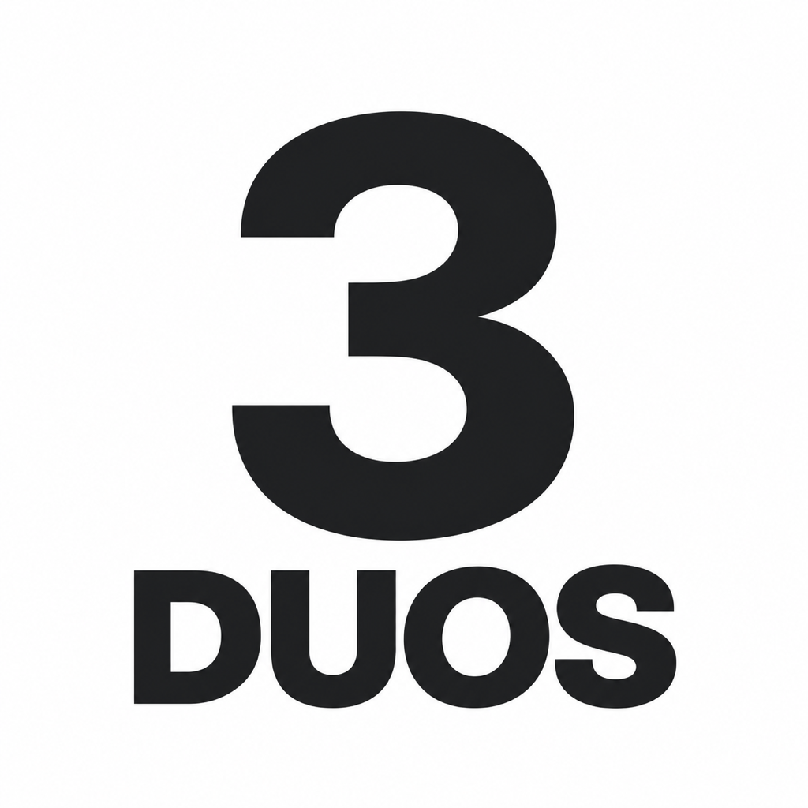
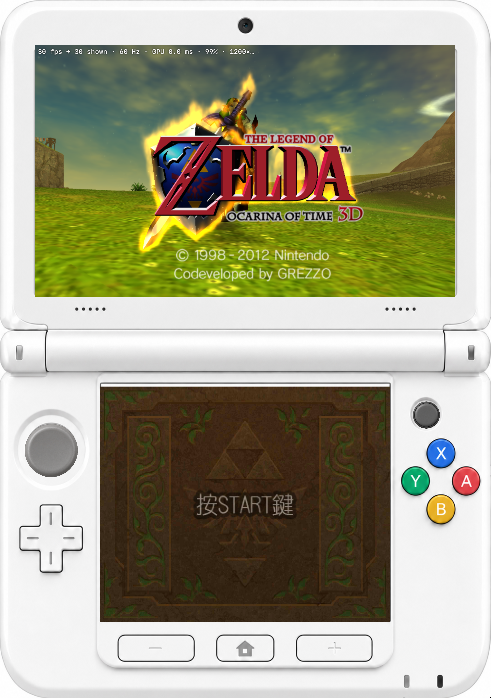
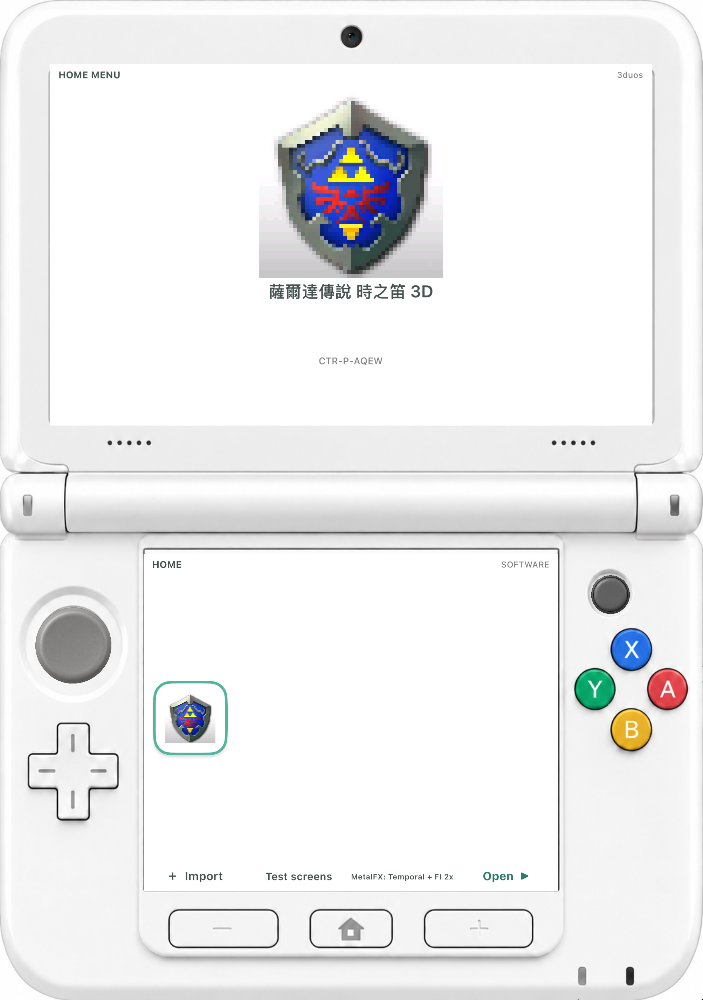
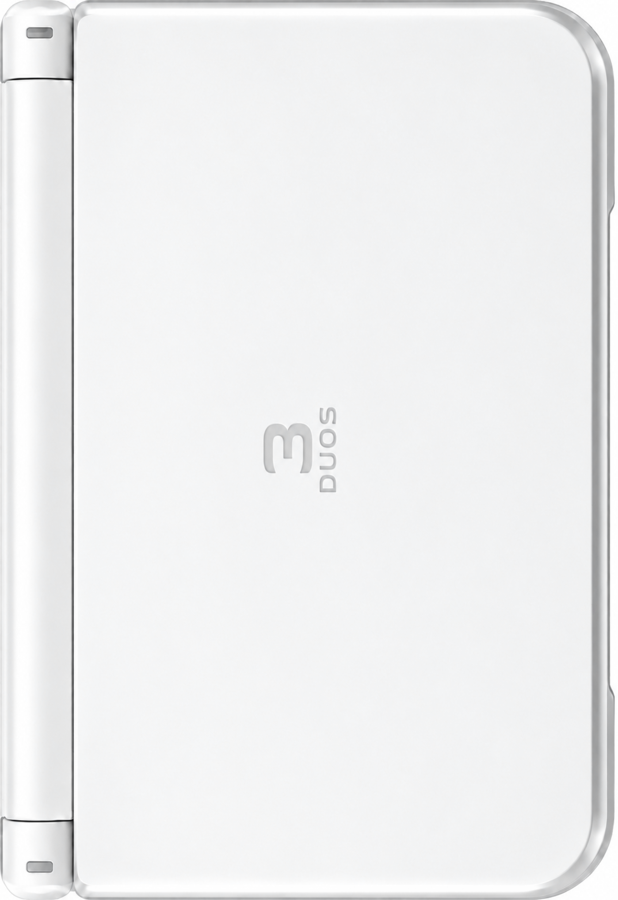

<p align="center">
  
</p>

<h1 align="center">3duos</h1>

<p align="center">把 iPhone Duo 变成一台白色双屏掌机。</p>

<p align="center">A self-developed 3DS emulator for iPhone Duo, with native Metal rendering and MetalFX.</p>

3duos 围绕折叠屏重新做了一套掌机体验：合上是白色外盖，展开是 New 3DS XL 风格双屏，摇杆、按键和下屏都可以直接触控。CPU、系统服务和图形核心在本项目中独立实现，应用只链接 Apple 系统框架。

**[下载预览版 IPA](https://github.com/OceanJy333/3duos/releases)** · [自动构建记录](https://github.com/OceanJy333/3duos/actions/workflows/release.yml)

发布的 IPA 为未签名版本，需要用自己的 Apple ID 和签名工具安装。最低系统为 iOS/iPadOS 26。

## 看看效果

<table>
  <tr>
    <th>游戏双屏 · Duo 模拟器</th>
    <th>HOME 游戏库 · Duo 模拟器</th>
    <th>合盖外屏 · Duo 真机</th>
  </tr>
  <tr>
    <td align="center"></td>
    <td align="center"></td>
    <td align="center"></td>
  </tr>
</table>

截图来自实际应用运行；机身皮肤使用 AI 生成素材，游戏画面由自研核心渲染。

## 已经做到什么

| 部分 | 当前实现 |
| --- | --- |
| 游戏执行 | ARM11 A32 解释器、线程调度、SVC 与 HLE 系统服务 |
| 图形 | PICA200 命令处理、原生 Metal 渲染、PICA 顶点程序转译为专用 Metal 着色器 |
| 高清显示 | 提高内部渲染分辨率；向 MetalFX 提供渲染器输出的深度、运动矢量和亚像素抖动 |
| 超分与插帧 | Off、Spatial、Temporal、Temporal + 2 倍 Frame Interpolation 四档；默认最后一档 |
| 折叠交互 | 合盖显示外壳并暂停游戏；展开恢复同一个会话 |
| 掌机外观 | 全白 XL 皮肤、加大上屏、彩色 ABXY、触控摇杆与按键反馈 |
| 不同比例 | Duo、长屏 iPhone、16:9 iPhone、iPad 各用固定比例机身图；屏幕、摇杆与按键按对应图片校准 |
| 游戏库 | 导入解密游戏，读取标题、图标和产品码；HOME 返回游戏库后可继续游戏 |
| 音频与存档 | DSP 音频通路、本地游戏存档 |

当前主要用《塞尔达传说：时之笛 3D》验证，已在 iPhone Duo 真机、Duo 模拟器与 Mac Catalyst 上运行过。其他游戏尚未完成兼容性测试。

默认显示链为 **60 Hz**。对 30 fps 游戏，2 倍插帧生成中间画面，目标是以 60 帧显示；游戏逻辑仍按自身帧率运行。上屏使用 Temporal 与插帧，下屏游戏界面使用 Spatial。具体效果取决于设备对 MetalFX 的支持。

普通 iPhone 与 iPad 固定竖屏，按设备类型与屏幕比例选择整张皮肤。机身内部不做动态重排；同一皮肤中的图片、显示区和触控区域整体等比缩放。不同型号留白略有差异。

## 构建与运行

### 准备环境

- macOS、Xcode 27.2，完成首次启动和命令行工具设置。
- [XcodeGen](https://github.com/yonaskolb/XcodeGen)；本项目验证版本为 2.45.4。
- 运行 Duo 模拟器时，需要安装 iOS 27.2 对应的模拟器运行时。
- 项目最低部署目标为 iOS 26；Duo 折叠状态交互使用 iOS 27.1+ 接口。

### 打开工程

```sh
git clone https://github.com/OceanJy333/3duos.git
cd 3duos
xcodegen generate
open 3duos.xcodeproj
```

在 Xcode 里选择 `3duos` scheme，再选择 iPhone Duo 模拟器或自己的设备运行。

真机签名在 Xcode 的 Signing & Capabilities 中选择自己的 Team。需要持久修改 Bundle ID、签名或构建设置时，编辑 [project.yml](project.yml) 后重新生成工程。

### 命令行构建

Duo 模拟器：

```sh
xcodebuild -project 3duos.xcodeproj -scheme 3duos \
  -configuration Debug -sdk iphonesimulator \
  -destination 'platform=iOS Simulator,name=iPhone Duo' \
  -derivedDataPath build/Simulator \
  CODE_SIGNING_ALLOWED=NO build
```

检查 iOS 设备目标编译，不进行签名安装：

```sh
xcodebuild -project 3duos.xcodeproj -scheme 3duos \
  -configuration Debug -sdk iphoneos \
  -destination 'generic/platform=iOS' \
  -derivedDataPath build/iOS \
  CODE_SIGNING_ALLOWED=NO build
```

工程也开启了 Mac Catalyst 支持，可在 Xcode 中选择对应的 My Mac 目标运行。

### 打包 IPA 与发布

本地生成未签名 Release IPA（含 CPU、4 套素材坐标及 7 种竖屏尺寸的检查）：

```sh
bash scripts/build-ipa.sh 0.1.1 1
```

输出为 `build/release/3duos-0.1.1-unsigned.ipa` 及对应的 SHA-256 文件。

GitHub Actions 使用 Xcode 27.2 构建，无需保存开发者证书。手动运行 **Build IPA** 可下载构建产物；推送 `v0.1.1` 这样的版本标签，会自动构建并发布预览 Release。变更说明见 [本版说明](docs/RELEASE.md)。

## 导入与操作

1. 打开应用，点击下屏的 **＋ Import**。
2. 选择自己导出的、已解密的 `.3ds`、`.cci` 或 `.cxi` 文件。
3. 在游戏库选中游戏，再点 **Open**。再次点击已选中的游戏图标也可以启动。
4. 游戏中按机身底部 **HOME** 返回游戏库；再次 Open 同一游戏可继续当前会话。
5. 在游戏库点击 **MetalFX** 切换显示档位，下一次 Open 时应用。

导入的游戏保存在应用的 `Documents/games`，存档位于 `Documents/saves`。ZIP、CIA 和加密游戏文件当前不能直接导入运行。仓库不包含游戏文件、系统固件或密钥。

触控操作包括左摇杆、十字键、ABXY、Start、Select 和下屏。右侧 C-stick 已有触控外观，其游戏侧输入映射仍待补齐。`Test screens` 用于检查显示通路，展示的是合成测试画面。

Mac 与模拟器支持键盘操作：

| 键盘 | 掌机按键 |
| --- | --- |
| 方向键 | 十字键 |
| Z / X | A / B |
| S / A | X / Y |
| Return / Space | Start / Select |
| Q / W | L / R |

## 代码从哪里看

```text
App/                应用入口、游戏库、后台执行与帧调度
UI/                 掌机皮肤、折叠展示、触控和 HOME 界面
Core/CPU/           ARM11 解释器
Core/Memory/        访客内存
Core/Kernel/        线程、同步对象与 SVC
Core/Services/      FS、GSP、HID、DSP、APT 等系统服务
Core/Cartridge/     卡带、程序段与图标解析
Core/GPU/           PICA200、Metal 后端与顶点着色器编译
Core/Graphics/      双屏呈现、MetalFX 与插帧
Tests/              独立核心检查与启动探针
```

- [设计与交互](DESIGN.md)：内外屏布局、折叠行为与控件对齐。
- [素材与生图提示词](Design/ASSETS.md)：皮肤、图标和生成记录。
- [开发交接与实验记录](HANDOFF.md)：按日期保留的进展、性能探索与调试入口。
- [早期架构笔记](ARCHITECTURE.md)：初始拆分与格式研究；其中进度描述保留了早期状态。

## 验证与调试

核心检查按模块放在 [Tests](Tests)，包括 CPU、卡带解析、GPU、顶点编译器、显示与 MetalFX。

一个最小 CPU 检查：

```sh
mkdir -p build
xcrun swiftc Core/CPU/*.swift Tests/CPU/main.swift -o build/cpu-check
build/cpu-check
```

[MetalFX 检查](Tests/MetalFX/README.md)使用合成场景验证超分与插帧；[启动探针](Tests/Boot)用于跟踪真实程序执行。合成测试通过与实际游戏兼容性分别验证。

在 Xcode scheme 的 Run → Arguments → Environment Variables 中可设置：

| 变量 | 用途 |
| --- | --- |
| `TDS_OPEN=1` | 启动后直接打开选中的游戏 |
| `TDS_HUD=1` | 显示游戏帧率、输出帧率与 GPU 耗时 |
| `TDS_EFFECT=0…3` | 按上面的四档顺序指定显示模式 |
| `TDS_BENCH=1` | 运行 MetalFX 性能探针 |
| `TDS_SHADERDUMP=/path/to/folder` | 导出 PICA 顶点程序，供编译器对照检查 |

## 参与开发

欢迎提交可复现的游戏兼容问题、图形错误与输入问题。Issue 中附上游戏名称和版本、设备与系统版本、MetalFX 档位、复现步骤及截图，便于定位。

## License

[MIT](LICENSE)。Nintendo 3DS 与《塞尔达传说》相关商标归任天堂及其权利人所有。
